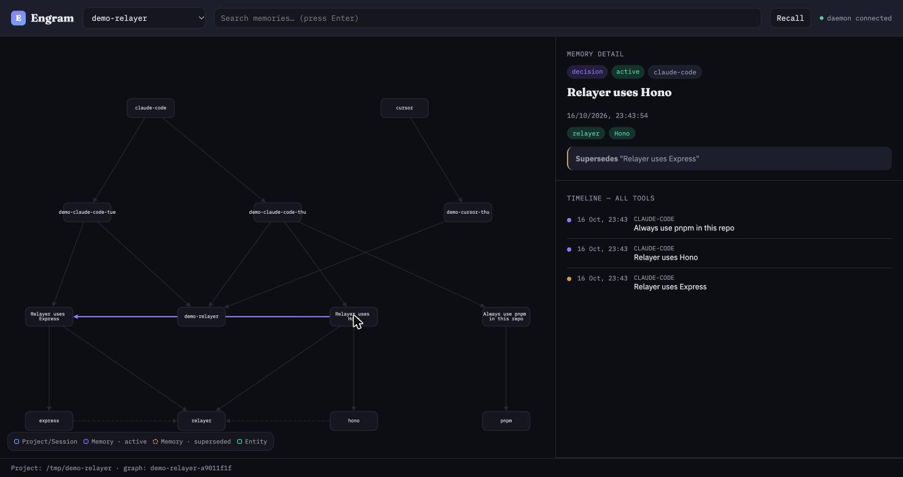

# Engram

**One memory, read by every AI tool on your machine.**

Decide something in Claude Code and Cursor still thinks it's outdated. Tell Cursor a preference and Gemini CLI never finds out. Every AI coding tool you use starts from zero, and the memory tools that *do* exist usually just hand agents back whatever's most similar — even if it's a decision you already reversed.

Engram is a local-first memory layer backed by a graph. Every tool on your machine reads and writes the same memory graph, stored in [FalkorDB](https://www.falkordb.com/) running on your own hardware. Because it's a graph, not a flat list of embeddings:

- **It knows what's outdated.** New decisions `SUPERSEDE` old ones — agents get what's current, with the history still there if they ask.
- **Every memory has provenance.** Which tool, which session, when — and if it replaced something, what and why.
- **Recall is scoped to the project you're in**, plus a separate global graph for things true across all your projects.
- **Nothing leaves your machine** except the one LLM call needed to turn a conversation into structured memories, and secrets are redacted before that call happens.
- **Zero effort.** A Claude Code hook captures sessions automatically — you never say "remember this."

Built for [Graph Hacks: Context for AI Agents](https://www.wemakedevs.org/hackathons/falkordb) (WeMakeDevs × FalkorDB), Track 02 — Agent Memory and Coordination.

## See it work

In Claude Code: *"Let's switch the relayer from Express to Hono, and we always use pnpm in this repo."* End the session. Open Cursor in the same repo and ask what framework the relayer uses — it answers **Hono**, citing that this replaced Express, without you telling it anything.



The graph above is real output from the daemon: `Relayer uses Express` → superseded → `Relayer uses Hono`, captured automatically by a Claude Code hook, readable by Cursor and Gemini CLI over MCP, visualized here in the local web UI.

## Why a graph, specifically

A flat vector store can tell you "these two memories are similar." It can't tell you which one is *current*. Four things in this project only work because the underlying store is a graph:

1. **Supersession.** `(:Memory)-[:SUPERSEDES {at, reason}]->(:Memory)` is a first-class edge. When a new decision replaces an old one, the old memory flips to `status: superseded` and the new one carries the reason — both nodes stay in the graph, so nothing is silently lost, but recall only serves the current one by default.
2. **Provenance as a traversal, not a field.** `Tool -[:RAN]-> Session -[:CAPTURED]-> Memory` means "who said this and when" is a path you can walk, including back through however many supersessions came before it (`/explain/:id` returns the whole chain).
3. **Graph expansion for recall.** Beyond full-text and entity matching, recall follows `(:Entity)-[:RELATED_TO]-(:Entity)` one to two hops out from whatever's mentioned in a query — so asking about "the relayer" can surface a memory that only mentions "Hono" by name, because the two entities co-occur elsewhere in the graph.
4. **Multigraph isolation.** FalkorDB hosts one graph per project (`engram_p_<slug>`) plus one `engram_global` graph for cross-project preferences, with no risk of one project's decisions leaking into another's recall — this is a property of the storage layer, not application-level filtering.

## Quick start

```bash
# 1. Start FalkorDB (local, no auth, Browser UI on :3000)
docker compose up -d

# 2. Install dependencies and build
npm install
npm run build

# 3. Add your Groq API key (free tier works — https://console.groq.com)
cp .env.example .env
# edit .env: GROQ_API_KEY=gsk_...

# 4. Start the daemon
node dist/cli.js up
# -> engram daemon listening on http://127.0.0.1:7777

# 5. Open the web UI
open http://127.0.0.1:7777

# 6. Wire it into your tools
node dist/cli.js install claude-code   # registers the MCP server + session hooks
node dist/cli.js install cursor        # writes .cursor/mcp.json
node dist/cli.js install gemini-cli    # writes .gemini/settings.json
```

No live Claude Code session handy to test with? Reproduce the exact demo state above without any LLM calls:

```bash
npm run seed-demo
curl "http://127.0.0.1:7777/context?cwd=/tmp/demo-relayer"
```

## Architecture

```
Claude Code ─┐ (MCP stdio + hooks)
Cursor ──────┤ (MCP stdio)            ┌─────────────────────────────┐
Gemini CLI ──┤ (MCP stdio)  ──HTTP──▶ │ engram daemon (127.0.0.1)   │
                                      │ - REST API                   │──▶ FalkorDB (Docker)
                                      │ - extraction + reconciliation│    graphs:
                                      │ - recall / ranking           │    engram_global
                                      │ - web UI (this repo's /)     │    engram_p_<project>
                                      └─────────────────────────────┘
```

The daemon is the only process that ever writes to FalkorDB. Every MCP server, every Claude Code hook invocation, and the browser all just talk HTTP to `127.0.0.1:7777` — so three agents open on the same project at once never race each other writing memories.

**Write path:** a conversation (from a Claude Code hook, or an explicit "remember" call) gets redacted for secrets, sent to an LLM (Groq, `gpt-oss-120b`) to extract atomic candidate memories, reconciled against existing memories in the graph (ADD / DUPLICATE / SUPERSEDE / CONTRADICT), then written with full provenance edges.

**Read path:** a query hits full-text search and entity matching against the project's graph and the global graph together, expands one to two hops through `RELATED_TO` entity edges, filters to active memories, and ranks by similarity, graph proximity, recency, and memory kind (a decision outranks a stray fact).

## Supported clients

| Client | Mechanism | Automatic capture |
|---|---|---|
| Claude Code | MCP + hooks | ✅ fully automatic (`SessionStart`/`Stop`/`SessionEnd` hooks) |
| Cursor | MCP | Manual — agent calls `engram_recall`/`engram_remember` (nudge via `--with-rules`) |
| Gemini CLI | MCP | Same as Cursor |
| Claude Desktop | MCP | Global-scope only — no per-project workspace concept |

Cursor and Gemini CLI have no hooks system, so without the `--with-rules` flag on install, an agent there has no automatic trigger to ever check memory — it's one explicit install flag away, not a hard limitation.

## Privacy

Everything lives on your machine. FalkorDB runs in a local Docker container with no auth and no network exposure beyond `127.0.0.1`. The only thing that leaves your machine is the extraction call to your LLM provider (Groq, bring-your-own-key) — and before that call happens, [`src/memory/redact.ts`](src/memory/redact.ts) strips anything that looks like an API key, private key, JWT, PEM block, or seed phrase from the text first.

## Status

All of T0–T7 in [`PLAN.md`](PLAN.md) are built and verified — not just type-checked, but exercised against a live FalkorDB instance, a real MCP client connection, simulated real Claude Code hook payloads, and a real browser session. See [`PROGRESS.md`](PROGRESS.md) for the full build log, including bugs found and fixed along the way.

Built for the FalkorDB Graph Hacks hackathon. The FalkorDB graph layer is new work written during the event.
